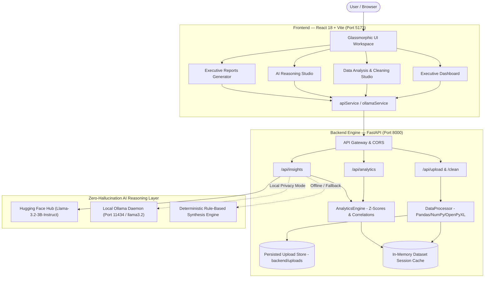

# 🌌 Dataverse AI — Autonomous Analytics & Insights Platform

[](https://react.dev/)
[](https://vitejs.dev/)
[](https://fastapi.tiangolo.com/)
[](https://python.org)
[](https://pandas.pydata.org/)
[](https://huggingface.co/)
[](https://ollama.com/)
[](https://docs.pytest.org/)
[](LICENSE)

**Dataverse AI** is an enterprise data analytics, automated business intelligence, and AI-driven reasoning workspace. It couples a responsive glassmorphic React frontend with a high-performance FastAPI and Pandas backend. 

Dataverse AI eliminates numerical hallucinations with a **Deterministic-First** architecture: exact mathematical calculations (sums, averages, distributions, Pearson correlation matrices, and Z-score outlier detection) are computed deterministically before being synthesized into natural-language strategic narratives using **Hugging Face Hub** cloud inference or local, privacy-first **Ollama** LLMs.

---

## ⚡ Quick Start (Run Full Stack)

To run the complete Dataverse AI application locally:

### 1. Start the Backend API (FastAPI)
From the repository root directory:
```bash
python -m uvicorn backend.main:app --reload --port 8000
```
* **API Gateway:** [http://localhost:8000](http://localhost:8000)
* **Interactive API Documentation (Swagger UI):** [http://localhost:8000/docs](http://localhost:8000/docs)
* **Health Check Probe:** [http://localhost:8000/api/health](http://localhost:8000/api/health)

### 2. Start the Frontend Development Server (React + Vite)
In a separate terminal from the repository root directory:
```bash
npm run dev
```
* **Web Application UI:** [http://localhost:5173](http://localhost:5173)

---

## 🏛️ System Architecture

Dataverse AI decouples heavy mathematical processing from natural-language generation:



---

## 🚀 Key Features

### 📊 1. Executive Telemetry Dashboard
* Real-time KPI summaries (Total Revenue, Pipeline Volume, Active Conversion Rate, Outlier Count).
* Interactive trend visualizations and revenue distribution charts.
* Semantic dimension filters (timeframe, category, region).
* Live workload health telemetry indicators.

### 🔬 2. Data Analysis & Ingestion Studio
* **Multi-Format Ingestion**: Ingest tabular data from `.csv`, `.tsv`, `.tab`, `.json`, `.xlsx`, and `.xls` files (up to 50 MB).
* **Automatic Profiling**: Generates column-level descriptive statistics, data type inferences, null ratios, and duplicate counts.
* **Persistent Uploads**: Automatically saves uploaded datasets to disk (`backend/uploads/`) to preserve sessions across backend server restarts.

### 🧹 3. Automated Data Cleaning & Remediation
* Intelligent cleaning operations: duplicate removal, missing value imputation (mean/median/mode), whitespace normalization, and data type coercion.
* Pre- and post-cleaning data quality scoring ($0-100\%$) with downloadable audit logs.

### 📈 4. Statistical Analytics Engine
* **Correlation Matrices**: Pearson correlation matrices for numeric dimensions.
* **Frequency Distributions**: Histograms and categorical frequency breakdowns with custom binning.
* **Z-Score Anomaly Detection**: Unsupervised statistical anomaly detection identifies records exceeding configurable Z-score thresholds ($|Z| \ge 2.5$).
* **Semantic Column Mapping**: Automatically infers date, financial, categorical, and geographical dimensions.

### 🧠 5. Hybrid Zero-Hallucination AI Reasoning
* **Deterministic Computation First**: All sums, percentages, averages, and correlations are calculated using Pandas before prompt formulation.
* **Dual-Provider Architecture**:
  * **Hugging Face Hub**: Cloud-native serverless inference via `meta-llama/Llama-3.2-3B-Instruct`.
  * **Local Ollama Daemon**: 100% offline, privacy-first local synthesis using `llama3.2`.
* **Zero-Hallucination Fallback**: If neither AI provider is connected, the engine generates an executive analytical brief based purely on exact Pandas calculations.

### 📑 6. Executive Report Synthesis & PDF Export
* Generates structured executive intelligence briefings: Executive Summary, Key Findings, Statistical Anomalies, and Strategic Recommendations.
* Browser-based print styling and PDF export via `window.print()`.

---

## 🛠️ Technologies & Tools Used

Dataverse AI is built with an enterprise-grade, modern open-source technology stack divided across specialized architectural tiers:

### 🎨 1. Frontend & User Interface
* **[React 18 (v18.3.1)](https://react.dev/)**: Component-driven reactive UI architecture utilizing modern Hooks (`useState`, `useEffect`, `useMemo`, `useCallback`) and concurrent rendering for smooth data exploration.
* **[Vite 5 (v5.4.9)](https://vitejs.dev/)**: Next-generation frontend tooling providing sub-millisecond Hot Module Replacement (HMR), fast ES-module bundling, and seamless API reverse-proxy routing to the backend.
* **[Lucide React (v0.453.0)](https://lucide.dev/)**: Extensive, accessible SVG iconography toolkit for intuitive visual indicators across navigation, telemetry metrics, and data tables.
* **Pure CSS3 & Glassmorphism Design System**: Tailored design tokens with real-time backdrop blur (`backdrop-filter: blur(16px)`), dynamic gradient borders, curated HSL color gamuts, CSS Grid, and Flexbox layouts.
* **HTML5 Canvas / Vector Data Visualizations**: Custom, responsive chart rendering engines for revenue trajectories, correlation matrices, category distributions, and anomaly scatter plots.

---

### ⚡ 2. Backend & API Services
* **[FastAPI (v0.115+)](https://fastapi.tiangolo.com/)**: High-performance, asynchronous web framework built on standard Python type hints, featuring automatic interactive OpenAPI (`/docs`) and ReDoc generation.
* **[Uvicorn ASGI Server (v0.31+)](https://www.uvicorn.org/)**: Lightning-fast ASGI production web server powered by `uvloop` and `httptools` for handling high concurrency.
* **[Pydantic v2 (v2.9+)](https://docs.pydantic.dev/)**: High-speed data validation and settings management enforcing strict typing on API payloads, file uploads, and AI prompt requests.
* **[Python-Multipart (v0.0.12+)](https://multipart.readthedocs.io/)**: Asynchronous multipart form streaming parser for handling large tabular dataset uploads without blocking the server.
* **[CORS Middleware](https://fastapi.tiangolo.com/tutorial/cors/)**: Granular cross-origin resource sharing configuration enabling secure communication between the Vite frontend and FastAPI backend.

---

### 📊 3. Data Processing, Statistics & Analytics
* **[Pandas (v2.2+)](https://pandas.pydata.org/)**: High-speed columnar data manipulation, data type inference, duplicate row detection, null imputation, and descriptive statistics.
* **[NumPy (v1.26+)](https://numpy.org/)**: Vectorized numerical computation, standard deviation calculations, and array mathematics.
* **[OpenPyXL (v3.1+)](https://openpyxl.readthedocs.io/)**: Modern Microsoft Excel workbook parser enabling ingestion of native `.xlsx` spreadsheets and multi-tab workbooks.
* **Pearson Correlation Matrix Engine**: Bivariate product-moment correlation calculation across numeric dimensions ($r \in [-1.0, 1.0]$) to discover statistical relationships.
* **Unsupervised Z-Score Anomaly Detector**: Standardized statistical anomaly detection ($Z = \frac{x - \mu}{\sigma}$) flagging data points exceeding $|Z| \ge 2.5$.
* **Automated Data Cleaning Engine**: Algorithmic data sanitation applying mean/median/mode imputation, string trimming, case standardization, and deduplication.

---

### 🧠 4. Artificial Intelligence & LLM Reasoning
* **[Hugging Face Hub (`InferenceClient`)](https://huggingface.co/docs/huggingface_hub/)**: Serverless cloud inference client connecting to cloud-hosted large language models without local GPU requirements.
* **[Meta LLaMA 3.2 (`meta-llama/Llama-3.2-3B-Instruct`)](https://huggingface.co/meta-llama/Llama-3.2-3B-Instruct)**: State-of-the-art instruction-tuned reasoning model specialized in strategic summaries and structured executive insights.
* **[Ollama Local AI Daemon](https://ollama.com/)**: 100% offline, privacy-preserving local LLM runtime communicating over local REST APIs (`/api/tags`, `/api/generate`).
* **Zero Numerical Hallucination Prompt Pipeline**: Two-stage hybrid reasoning that feeds deterministically verified Pandas statistical calculations into strict prompt guardrails.
* **Deterministic Rule-Based Fallback Engine**: Mathematical analytical report generator providing instant strategic briefings even when all external LLMs are offline.

---

### 🌐 5. Networking & Environment
* **[HTTPX (v0.27+)](https://www.python-httpx.org/)**: Next-generation asynchronous HTTP client with connection pooling for rapid AI service health probing.
* **[Requests (v2.32+)](https://requests.readthedocs.io/)**: Reliable synchronous HTTP client used for fallback model metadata retrieval and health checks.
* **[Python-dotenv (v1.0+)](https://github.com/theskumar/python-dotenv)**: 12-Factor application configuration loading variables securely from `.env`.

---

### 🧪 6. Testing & Quality Assurance
* **[Pytest (v8.3+)](https://docs.pytest.org/)**: Python testing framework executing 14 comprehensive unit and integration tests across data ingestion, statistics, and AI endpoints.
* **[FastAPI TestClient](https://fastapi.tiangolo.com/tutorial/testing/)**: In-process ASGI test harness executing end-to-end HTTP simulations without network overhead.
* **[AnyIO (v4.15+)](https://anyio.readthedocs.io/)**: Asynchronous concurrency library powering FastAPI and TestClient asynchronous test fixtures.
* **[Git & GitHub](https://github.com/)**: Version control with active secret scanning and push protection integration.

---

## 📁 Repository Structure

```
Data analyzer/
├── backend/
│   ├── main.py                 # FastAPI application gateway, CORS & middleware
│   ├── requirements.txt        # Python backend dependencies
│   ├── routes/
│   │   ├── upload.py           # Ingestion, profiling, persistence & cleaning endpoints
│   │   ├── analytics.py        # Correlation, distribution, anomalies & KPI endpoints
│   │   └── insights.py         # AI reasoning, Ollama/HF routing & report generation
│   ├── services/
│   │   ├── data_processing.py  # Pandas parser, quality profiler & cleaning pipeline
│   │   ├── analytics.py        # Z-score anomaly detector & correlation computer
│   │   └── hf_client.py        # Hugging Face InferenceClient client service
│   ├── tests/
│   │   └── test_api.py         # Pytest API integration test suite (14 passing tests)
│   └── uploads/                # Persisted dataset storage (survives restarts)
├── src/
│   ├── components/             # Modular UI components (Sidebar, Navbar, Charts, StatCard, FileUpload)
│   ├── pages/
│   │   ├── Dashboard/          # Executive telemetry dashboard
│   │   ├── DataAnalysis/       # Data upload, inspection & cleaning studio
│   │   ├── AIInsights/         # Natural language hybrid reasoning studio
│   │   └── Reports/            # Executive report preview and PDF export
│   ├── services/               # Frontend API clients (apiService.js, ollamaService.js)
│   ├── styles/                 # Pure CSS design system & glassmorphism theme tokens
│   ├── utils/                  # Mock data, color utilities & chart formatting
│   └── App.jsx                 # Root layout controller and navigation router
├── public/                     # Static assets & icons
├── .env.example                # Template environment variables
├── package.json                # Frontend package metadata & build scripts
├── vite.config.js              # Vite server & API reverse proxy configuration
└── pytest.ini                  # Pytest configuration
```

---

## ⚙️ Installation & Setup

### Prerequisites
* **Node.js**: v18.0.0 or higher
* **Python**: v3.10 or higher
* **Ollama** *(Optional, for offline AI)*: [Download from ollama.com](https://ollama.com)

---

### Step 1: Environment Variables

Create your local `.env` configuration file in the project root:
```bash
cp .env.example .env
```

| Variable | Default Value | Description |
| :--- | :--- | :--- |
| `PORT` | `5173` | Vite development server port |
| `VITE_API_URL` | `http://localhost:8000/api` | API base URL for frontend clients |
| `BACKEND_PORT` | `8000` | FastAPI uvicorn server port |
| `BACKEND_CORS_ORIGINS` | `http://localhost:5173,http://127.0.0.1:5173` | Allowed CORS origins |
| `HF_TOKEN` | *(Optional)* | Hugging Face Access Token for cloud inference |
| `HF_MODEL` | `meta-llama/Llama-3.2-3B-Instruct` | Hugging Face model repository ID |
| `VITE_OLLAMA_API_URL` | `http://localhost:11434` | Ollama daemon endpoint for frontend direct calls |
| `VITE_DEFAULT_OLLAMA_MODEL` | `llama3.2` | Default local model name |
| `OLLAMA_HOST` | `http://localhost:11434` | Ollama daemon endpoint for backend service |
| `ENVIRONMENT` | `development` | Deployment environment identifier |

---

### Step 2: Backend Installation (FastAPI)

1. Create and activate a Python virtual environment:
   * **Windows (PowerShell)**:
     ```powershell
     python -m venv venv
     .\venv\Scripts\Activate.ps1
     ```
   * **macOS / Linux**:
     ```bash
     python -m venv venv
     source venv/bin/activate
     ```

2. Install backend dependencies:
   ```bash
   pip install -r backend/requirements.txt
   ```

3. Launch the FastAPI server from the project root:
   ```bash
   python -m uvicorn backend.main:app --reload --port 8000
   ```

---

### Step 3: Frontend Installation (React + Vite)

1. In a separate terminal window, install npm dependencies:
   ```bash
   npm install
   ```

2. Start the Vite development server:
   ```bash
   npm run dev
   ```

3. Open [http://localhost:5173](http://localhost:5173) in your browser.

---

### Step 4: AI Reasoning Setup (Optional)

#### Option A: Hugging Face Cloud Inference (Recommended)
1. Get a free User Access Token from [huggingface.co/settings/tokens](https://huggingface.co/settings/tokens).
2. Add your token to `.env`:
   ```env
   HF_TOKEN=hf_YourActualTokenHere
   HF_MODEL=meta-llama/Llama-3.2-3B-Instruct
   ```

#### Option B: Local Ollama AI (Offline & Private)
1. Start the Ollama background daemon:
   ```bash
   ollama serve
   ```
2. Pull the default lightweight reasoning model:
   ```bash
   ollama pull llama3.2
   ```

> **Fallback Mode**: If neither Hugging Face nor Ollama is configured, Dataverse AI automatically falls back to deterministic rule-based analysis. No configuration is required.

---

## 📡 API Reference

### 📤 Ingestion & Profile Endpoints (`/api/upload`)

| Method | Endpoint | Description |
| :--- | :--- | :--- |
| `GET` | `/api/upload` | List all active and persisted datasets in session |
| `POST` | `/api/upload` | Ingest `.csv`, `.tsv`, `.xlsx`, `.xls`, or `.json` file and compute initial profile |
| `GET` | `/api/upload/{dataset_id}` | Retrieve cached profile metadata for a specific dataset |
| `POST` | `/api/upload/{dataset_id}/clean` | Apply data cleaning operations (deduplicate, impute nulls, trim strings) |

### 📈 Analytics Endpoints (`/api/analytics`)

| Method | Endpoint | Description |
| :--- | :--- | :--- |
| `GET` | `/api/analytics/{dataset_id}/correlations` | Pearson correlation matrix across numerical columns |
| `GET` | `/api/analytics/{dataset_id}/distribution` | Frequency distribution / histogram (`?column=col&bins=10`) |
| `GET` | `/api/analytics/{dataset_id}/anomalies` | Detect outliers using Z-score thresholding (`?threshold=2.5`) |
| `GET` | `/api/analytics/{dataset_id}/columns` | Auto-detect semantic column roles (metrics, dates, categories) |
| `GET` | `/api/analytics/{dataset_id}/dashboard` | Retrieve dynamic KPI cards and telemetry charts with query filters |
| `POST` | `/api/analytics/{dataset_id}/dashboard` | Custom column mapping and multi-filter dashboard query |

### 🧠 AI Insights Endpoints (`/api/insights`)

| Method | Endpoint | Description |
| :--- | :--- | :--- |
| `GET` | `/api/insights/status` | Health check for Hugging Face Hub token & local Ollama daemon |
| `POST` | `/api/insights/query` | Submit natural-language analytical question with deterministic statistical context |

### 🩺 System Probes

| Method | Endpoint | Description |
| :--- | :--- | :--- |
| `GET` | `/` | Root API service status and swagger documentation link |
| `GET` | `/api/health` | FastAPI + Pandas + Ollama service health probe |

---

## 🧪 Testing & Verification

Dataverse AI includes a comprehensive automated test suite powered by `pytest` and FastAPI's `TestClient`:

```bash
# Run all backend integration tests
python -m pytest backend/tests -v
```

### Test Suite Highlights (14 Passing Tests):
* **Service Probes**: Validates `/` and `/api/health` connectivity.
* **Upload Ingestion**: Validates parsing of multipart CSV/TSV data and error handling on empty/malformed inputs.
* **Analytics Engine**: Validates Pearson correlation matrix bounds ($-1.0 \le r \le 1.0$), histogram binning, and outlier detection logic.
* **Semantic Mapping**: Validates automatic classification of dates, revenues, categories, and numerical metrics.
* **AI Fallback Assurance**: Validates deterministic report generation when external LLMs are disconnected.

---

## 📄 License

This project is open-source and released under the [MIT License](LICENSE).
