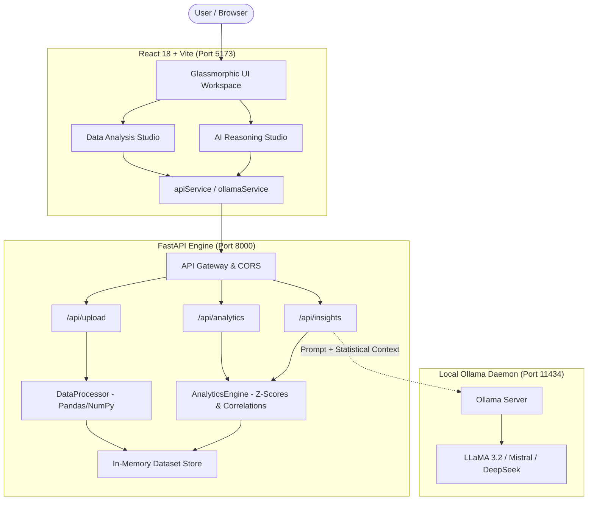

# 🌌 Dataverse AI — Autonomous Analytics & Insights Platform

[](https://react.dev/)
[](https://vitejs.dev/)
[](https://fastapi.tiangolo.com/)
[](https://python.org)
[](https://pandas.pydata.org/)
[](https://ollama.com/)
[](https://docs.pytest.org/)

**Dataverse AI** is a data analytics, business intelligence, and AI-driven insights workspace. It pairs a glassmorphic React frontend with a high-performance FastAPI and Pandas backend, complemented by a local, privacy-first **Ollama** LLM integration for statistical reasoning and strategic recommendations.

---

## 🏛️ System Architecture

Dataverse AI combines deterministic data computation with local LLM reasoning:



---

## 🚀 Key Features

* 📊 **Executive Dashboard**: Telemetry overview with KPI tracking, revenue and pipeline trend visualizations, category breakdowns, and workload health telemetry.
* 🔬 **Data Analysis Studio**: Ingest `.csv`, `.tsv`, or `.json` datasets. Automatically profiles column statistics, null rates, duplicate rows, data types, and value distributions.
* 📈 **Statistical Analytics Engine**: Calculates Pearson correlation matrices across numeric dimensions, frequency distributions, and statistical anomalies using Z-score outlier detection.
* 🧠 **Hybrid AI Reasoning Studio**:
  * **Deterministic First**: Computes exact mathematical sums, averages, and rankings via Pandas before LLM processing to prevent numerical hallucinations.
  * **Local Generative Synthesis**: Formulates structured analytical prompts for your local Ollama daemon (`llama3.2`) to deliver strategic commentary and prescriptive recommendations.
  * **Resilient Offline Fallback**: If Ollama is offline or uninstalled, the backend automatically provides verified deterministic metrics accompanied by an offline notice without failing.
* 📑 **Executive Reports**: Structured report summaries with browser print and PDF generation (`window.print()`).

---

## 🛠️ Technology Stack

| Layer | Technologies |
| :--- | :--- |
| **Frontend** | React 18, Vite 5, Lucide Icons, Pure CSS3 Design System with Glassmorphism tokens |
| **Backend API** | FastAPI, Uvicorn, Pydantic v2, Python-Multipart |
| **Data Engine** | Pandas 2.2+, NumPy 1.26+ |
| **AI Integration** | Local [Ollama](https://ollama.com) REST API (`/api/tags`, `/api/generate`), HTTPX, Requests |
| **Testing** | Pytest, FastAPI TestClient |

---

## ⚡ Getting Started

### Prerequisites

* **Node.js**: v18.0.0 or higher
* **Python**: v3.10 or higher
* **Ollama** *(Optional, for generative AI insights)*: [Download from ollama.com](https://ollama.com)

---

### 1. Backend Setup (FastAPI)

1. Open a terminal and navigate to the project root:
   ```bash
   cd backend
   ```

2. Create and activate a virtual environment:
   * **Windows (PowerShell)**:
     ```powershell
     python -m venv venv
     .\venv\Scripts\Activate.ps1
     ```
   * **macOS / Linux**:
     ```bash
     python -m venv venv
     source venv/bin/activate
     ```

3. Install the dependencies:
   ```bash
   pip install -r requirements.txt
   ```

4. Run the development server:
   ```bash
   uvicorn main:app --reload --port 8000
   ```
   * Backend API: `http://localhost:8000`
   * Interactive API Documentation (Swagger UI): `http://localhost:8000/docs`

---

### 2. Frontend Setup (React + Vite)

1. In another terminal, navigate to the project root:
   ```bash
   npm install
   ```

2. Start the Vite development server:
   ```bash
   npm run dev
   ```
   * The application will run at `http://localhost:5173`.

---

### 3. Local Ollama AI Setup (Privacy-First)

Dataverse AI communicates directly with a locally running Ollama instance on your machine:
* **Zero Cloud Secrets**: No API keys, passwords, or credit cards are needed.
* **Full Data Privacy**: Dataset schemas and queries remain on your local machine.

1. Ensure Ollama is installed and running:
   ```bash
   ollama serve
   ```

2. Pull the default lightweight model:
   ```bash
   ollama pull llama3.2
   ```

3. Test that the model is operational:
   ```bash
   ollama run llama3.2
   ```

> **Note**: If Ollama is not running, the application continues to operate smoothly. The Data Analysis Studio will perform all mathematical aggregations and statistical calculations deterministically.

---

## 📡 API Reference

| Method | Endpoint | Description |
| :--- | :--- | :--- |
| `GET` | `/` | Root service health and status indicator |
| `GET` | `/api/health` | Backend system health check |
| `POST` | `/api/upload` | Upload `.csv`, `.tsv`, or `.json` file for in-memory parsing and profiling |
| `GET` | `/api/upload/{dataset_id}` | Retrieve cached dataset summary profile |
| `GET` | `/api/analytics/{dataset_id}/correlations` | Compute Pearson correlation matrix for numeric columns |
| `GET` | `/api/analytics/{dataset_id}/distribution` | Generate histogram or category frequency breakdown |
| `GET` | `/api/analytics/{dataset_id}/anomalies` | Identify statistical outliers using Z-score thresholding |
| `GET` | `/api/insights/status` | Query Ollama daemon status and downloaded models |
| `POST` | `/api/insights/query` | Submit natural language query for hybrid deterministic + AI reasoning |

---

## 🧪 Running Tests

### Backend Unit & Integration Tests

Dataverse AI uses `pytest` and FastAPI's `TestClient` to validate endpoints:

```bash
python -m pytest backend/tests
```

**Test Coverage**:
* `GET /` and `GET /api/health` health probes
* File upload pipeline with multipart CSV data
* Correlation matrix generation
* Distribution histogram calculation
* AI Insights hybrid dispatch and fallback flow

---

## 🔍 Architecture Notes & Limitations

To ensure transparency regarding current project capabilities:

1. **In-Memory Dataset Store**: Uploaded datasets are maintained in server memory (`DATASET_STORE`). When the backend server restarts, previously uploaded datasets are cleared.
2. **Dashboard Demonstration Telemetry**: Dashboard KPIs and charts reflect demonstration business metrics (`src/utils/mockData.js`) to provide an immediate out-of-the-box overview.
3. **Report Generation**: The Executive Reports interface uses browser-based print styling (`window.print()`) for PDF export, rather than headless server-side document rendering.
4. **Local LLM Availability**: Generative AI text depends on the local Ollama daemon. If the daemon is unreachable, the system displays deterministic calculated facts alongside an offline indicator.

---

## 📄 License

This project is open-source and available under the [MIT License](LICENSE).
